

<picture><source media="(prefers-color-scheme: dark)" srcset="assets/hero-dark.svg"></picture>

<picture><source media="(prefers-color-scheme: dark)" srcset="assets/social-l-dark.svg"></picture><a href="https://t.me/"><picture><source media="(prefers-color-scheme: dark)" srcset="assets/social-1-dark.svg"></picture></a><a href="https://discord.com/"><picture><source media="(prefers-color-scheme: dark)" srcset="assets/social-2-dark.svg"></picture></a><a href="https://x.com/"><picture><source media="(prefers-color-scheme: dark)" srcset="assets/social-3-dark.svg"></picture></a><picture><source media="(prefers-color-scheme: dark)" srcset="assets/social-r-dark.svg"></picture>

<picture><source media="(prefers-color-scheme: dark)" srcset="assets/about-dark.svg"></picture>

<picture><source media="(prefers-color-scheme: dark)" srcset="assets/stack-dark.svg"></picture>

<a href="https://github.com/yava-code/noitarl"><picture><source media="(prefers-color-scheme: dark)" srcset="assets/project-noitarl-dark.svg"></picture></a>&nbsp;<a href="https://github.com/yava-code/WinPulse"><picture><source media="(prefers-color-scheme: dark)" srcset="assets/project-winpulse-dark.svg"></picture></a>

<a href="https://github.com/yava-code/OnlyDrive"><picture><source media="(prefers-color-scheme: dark)" srcset="assets/project-onlydrive-dark.svg"></picture></a>&nbsp;<a href="https://github.com/yava-code/Telegram-Cleaner"><picture><source media="(prefers-color-scheme: dark)" srcset="assets/project-telegram-cleaner-dark.svg"></picture></a>

<a href="https://github.com/yava-code/flythegame"><picture><source media="(prefers-color-scheme: dark)" srcset="assets/project-flythegame-dark.svg"></picture></a>

<picture><source media="(prefers-color-scheme: dark)" srcset="assets/stats-dark.svg"></picture>

<picture><source media="(prefers-color-scheme: dark)" srcset="assets/streak-dark.svg"></picture>

<picture><source media="(prefers-color-scheme: dark)" srcset="assets/wave-dark.svg"></picture>

<a href="https://example.com"><picture><source media="(prefers-color-scheme: dark)" srcset="assets/button-1-dark.svg"></picture></a>&nbsp;&nbsp;<a href="https://github.com/yava-code?tab=repositories"><picture><source media="(prefers-color-scheme: dark)" srcset="assets/button-2-dark.svg"></picture></a>

<a href="https://metawka.github.io/expressive-profile/?from=yava-code"><picture><source media="(prefers-color-scheme: dark)" srcset="assets/credit-dark.svg"></picture></a>

